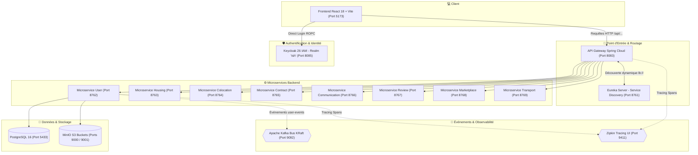
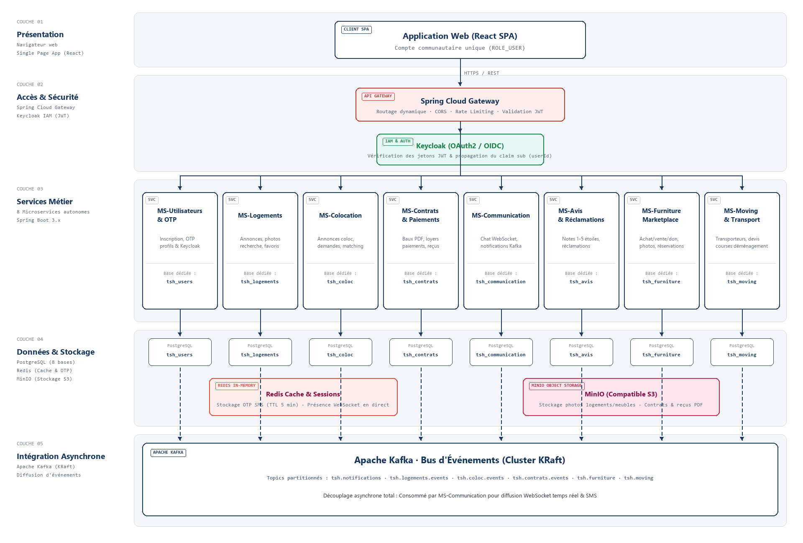

# 🏠 TSH — Trusted Student Housing

<div align="center">

[](https://www.oracle.com/java/)
[](https://spring.io/projects/spring-boot)
[](https://spring.io/projects/spring-cloud)
[](https://react.dev/)
[](https://www.keycloak.org/)
[](https://kafka.apache.org/)
[](https://zipkin.io/)
[](https://min.io/)
[](https://www.postgresql.org/)
[](https://www.docker.com/)

**Plateforme web communautaire pour étudiants en Tunisie**  
*Logements vérifiés · Colocation intelligente · Marketplace de meubles · Déménagement solidaire*

</div>

---

## 📑 Sommaire
- [🎯 Vision & Objectifs](#-vision--objectifs)
- [🏗️ Architecture Globale](#️-architecture-globale)
- [🌐 Tableau des Ports & Dashboards](#-tableau-des-ports--dashboards)
- [📁 Organisation du Code](#-organisation-du-code)
- [🛡️ Composants Transverses (Sécurité, Événements, Tracing)](#️-composants-transverses)
- [🚀 Guide de Démarrage Rapide](#-guide-de-démarrage-rapide)
- [🔑 Comptes de Test](#-comptes-de-test)

---

## 🎯 Vision & Objectifs

TSH (**Trusted Student Housing**) résout les difficultés d'hébergement des étudiants tunisiens :
1. **Zéro arnaque** : Logements certifiés et propriétaires vérifiés avec badge de confiance.
2. **Colocation par affinités** : Algorithme de compatibilité basé sur les rythmes de vie et habitudes d'études.
3. **Bail et paiements clairs** : Contrats numériques et suivi des échéances en ligne.
4. **Économie circulaire étudiante** : Vente de meubles d'occasion entre promotions et entraide pour le déménagement.

---

## 🏗️ Architecture Globale

Le projet repose sur une **architecture microservices distribuée**, découplée et résiliente :



### Diagramme de Conception


---

## 🌐 Tableau des Ports & Dashboards

Toutes les briques du projet sont centralisées et accessibles via des ports dédiés :

| Statut | Service / Outil | Port | URL / Point d'accès | Rôle & Utilité | Identifiants par défaut |
|:---:|:---|:---:|:---|:---|:---|
| 🟢 | **Frontend** | `5173` | [http://localhost:5173](http://localhost:5173) | Application Web étudiante (Vite + React) | — |
| 🟢 | **API Gateway** | `8083` | [http://localhost:8083](http://localhost:8083) | Point d'entrée unique, routage dynamique, CORS | — |
| 🟢 | **Swagger UI (Gateway)**| `8083` | [http://localhost:8083/swagger-ui.html](http://localhost:8083/swagger-ui.html) | Portail Swagger UI central avec sélecteur de microservices | — |
| 🟢 | **Eureka Discovery** | `8761` | [http://localhost:8761](http://localhost:8761) | Tableau de bord de découverte des services | — |
| 🟢 | **Keycloak IAM** | `8085` | [http://localhost:8085](http://localhost:8085) | Serveur OAuth2 / OIDC, gestion des utilisateurs & rôles | `admin` / `admin` |
| 🟢 | **User Service** | `8762` | [http://localhost:8762](http://localhost:8762) | Profils, rôles, avatars, auto-provisionnement | — |
| 🟢 | **Zipkin Tracing** | `9411` | [http://localhost:9411](http://localhost:9411) | Observabilité et graphique de latence des requêtes | — |
| 🟢 | **MinIO Web Console**| `9001` | [http://localhost:9001](http://localhost:9001) | Interface de gestion des fichiers & photos S3 | `minioadmin` / `minioadmin` |
| 🟢 | **MinIO S3 API** | `9000` | `http://localhost:9000` | Endpoint API compatible Amazon S3 | `minioadmin` / `minioadmin` |
| 🟢 | **PostgreSQL (Docker)**| `5433` | `localhost:5433` | Base de données principale (`tsh_users`, `keycloak`) | `postgres` / `postgres` |
| 🟢 | **PgWeb (DB Viewer)** | `8082` | [http://localhost:8082](http://localhost:8082) | Interface visuelle de consultation de `tsh_users` | Déjà connecté |
| 🟢 | **PgWeb (Keycloak DB)**| `8086` | [http://localhost:8086](http://localhost:8086) | Interface de consultation de la base `keycloak` | Déjà connecté |
| 🟢 | **Apache Kafka** | `9092` | `localhost:9092` | Broker d'événements asynchrones (mode KRaft) | — |
| ⚪ | **Housing Service** | `8763` | `http://localhost:8763` | Gestion des annonces immobilières et favoris | — |
| ⚪ | **Colocation Service**| `8764` | `http://localhost:8764` | Matching de colocataires & profils de vie | — |
| ⚪ | **Contract Service** | `8765` | `http://localhost:8765` | Baux numériques, PDF et quittances | — |
| ⚪ | **Communication** | `8766` | `http://localhost:8766` | Messagerie instantanée WebSocket & notifications | — |
| ⚪ | **Review Service** | `8767` | `http://localhost:8767` | Avis certifiés, réclamations et notes | — |
| ⚪ | **Marketplace** | `8768` | `http://localhost:8768` | Petites annonces de meubles d'étudiants | — |
| ⚪ | **Transport** | `8769` | `http://localhost:8769` | Déménagement et transport solidaire | — |

---

## 📁 Organisation du Code

```text
tsh-4das12-g3/
├── 📂 Backend/
│   ├── 📄 docker-compose.yml           # 🐳 Docker central : Postgres, Keycloak, MinIO, Kafka, Zipkin, PgWeb
│   ├── 📂 infrastructure/
│   │   ├── 📂 Eureka/                  # 🧭 Annuaire de découverte (Spring Cloud Netflix Eureka)
│   │   ├── 📂 Gateway/                 # 🚪 API Gateway réactive (Filtres CORS, headers sécurité, Actuator, Tracing)
│   │   └── 📂 keycloak/                # 🔐 Export du Realm "tsh" (utilisateurs, rôles, clients publics)
│   └── 📂 microservices/
│       ├── 📂 User/                    # 👤 Microservice Utilisateurs & Profil (18 tests validés, MinIO, Kafka)
│       ├── 📂 Housing/                 # 🏠 Microservice Annonces logements
│       ├── 📂 Colocation/              # 🤝 Microservice Colocation & Matching
│       ├── 📂 Contract/                # 📝 Microservice Contrats & Baux
│       ├── 📂 Communication/           # 💬 Microservice Messagerie & Notifications
│       ├── 📂 Review/                  # ⭐ Microservice Avis & Notations
│       ├── 📂 Marketplace/             # 🛋️ Microservice Meubles d'occasion
│       └── 📂 Transport/               # 🚚 Microservice Déménagement
│
├── 📂 Frontend/                        # 🎨 Application React 18 (Vite, TypeScript, Tailwind CSS)
│   ├── 📂 src/
│   │   ├── 📂 components/              # Composants réutilisables (AppShell, AdminShell, Layouts, Modals)
│   │   ├── 📂 lib/                     # API client, auth Keycloak, OIDC token management, toasts
│   │   ├── 📂 pages/                   # Pages publiques (Housing, Coloc, Meubles, Transport, Login, Onboarding)
│   │   │   ├── 📂 admin/               # Console d'administration sécurisée
│   │   │   └── 📂 app/                 # Espace étudiant connecté (Profil, Annonces, Contrats, Messages)
│   │   └── 📄 main.tsx                 # Point d'entrée avec ErrorBoundary anti-crash
│
├── 📂 Documentation/                   # 📚 Diagrammes d'architecture, cahier des charges
├── 📄 CONTRIBUTING.md                  # 👥 Guide d'intégration et instructions pour l'équipe
└── 📄 README.md                        # 📖 Ce document
```

---

## 🛡️ Composants Transverses

### 1. 🔐 Sécurité & Gestion des Identités (Keycloak 26)
- **Direct Grant (ROPC)** : La connexion s'effectue directement dans les formulaires de l'application sans redirection externe vers un écran tiers.
- **Rôles applicatifs** : `ROLE_USER` (étudiant / propriétaire) et `ROLE_ADMIN` (modérateur).
- **Auto-provisioning JIT** : Lors du premier appel après authentification, la table PostgreSQL `utilisateurs` crée automatiquement la ligne du profil étudiant.
- **Mots de passe** : Keycloak stocke les mots de passe de manière isolée avec hachage bcrypt fort dans sa propre base de données.

### 2. 📡 Événements Asynchrones (Apache Kafka en mode KRaft)
- Architecture orientée événements (*Event-Driven*) sans serveur Zookeeper externe.
- Le service `User` publie des événements sur le topic `user-events` (ex: `USER_CREATED`, `USER_UPDATED`).
- Permet aux services comme `Communication` d'envoyer des notifications sans couplage fort.

### 3. 📊 Traçabilité Distribuée (Zipkin & Micrometer)
- Chaque requête entrante reçoit un `traceId` unique via l'API Gateway.
- L'en-tête de traçage est propagé vers les microservices.
- Accessible en temps réel sur [http://localhost:9411](http://localhost:9411) pour diagnostiquer la latence et les erreurs.

### 4. 🗄️ Stockage d'Objets (MinIO S3)
Quatre buckets pré-configurés :
- `tsh-avatars` : Photos de profil des utilisateurs.
- `tsh-housing` : Photos des annonces d'appartements et colocations.
- `tsh-marketplace` : Photos des meubles d'occasion.
- `tsh-contracts` : Fichiers PDF des baux signés.

---

## 🚀 Guide de Démarrage Rapide

### Étape 1 : Démarrer l'infrastructure Docker
```bash
cd Backend
docker compose up -d
```
> Vérifiez que les 7 conteneurs sont `Up` avec `docker ps`.

### Étape 2 : Lancer les services Spring Boot (dans votre IDE)
Lancer dans l'ordre :
1. **`EurekaServerApplication`** (`Backend/infrastructure/Eureka`)
2. **`GatewayApplication`** (`Backend/infrastructure/Gateway`)
3. **`UserApplication`** (`Backend/microservices/User`)

### Étape 3 : Lancer le Frontend
```bash
cd Frontend
npm install
npm run dev
```
Rendez-vous sur [http://localhost:5173](http://localhost:5173).

---

## 🔑 Comptes de Test

Les comptes de démonstration suivants sont pré-chargés dans le Realm Keycloak `tsh` :

| Rôle | Adresse E-mail | Mot de passe | Espace accessible |
|---|---|---|---|
| 🎓 **Étudiant** | `etudiant@tsh.tn` | `etudiant123` | `/connexion` → Espace étudiant & profil |
| 🛡️ **Administrateur** | `admin@tsh.tn` | `admin123` | `/admin/connexion` → Console de modération |
| 📦 **MinIO Console** | `minioadmin` | `minioadmin` | `http://localhost:9001` → Buckets S3 |
| 🔐 **Keycloak Admin** | `admin` | `admin` | `http://localhost:8085` → Gestion Realm `tsh` |

---

## 🧪 Tests & Collection Postman

Une collection Postman complète et prête à l'emploi est fournie pour tester l'ensemble de l'architecture :
- 📁 **Fichier à importer dans Postman** : [`Documentation/TSH_Postman_Collection.json`](Documentation/TSH_Postman_Collection.json)
- **Contenu pré-configuré** :
  1. **Authentification OIDC** : Récupération et sauvegarde automatique des tokens JWT étudiant et admin.
  2. **API Gateway & User Service** : Consultation profil, mise à jour (déclenche Kafka), upload photo MinIO.
  3. **Santé & Monitoring** : Actuator Health Gateway & User, traces distribuées Zipkin.
  4. **Sécurité RBAC** : Vérification des accès refusés (401 sans token, 403 route admin avec token étudiant).

---

<div align="center">
  <sub>TSH — Trusted Student Housing · Projet 4DAS12 Groupe 3 · 2026</sub>
</div>
